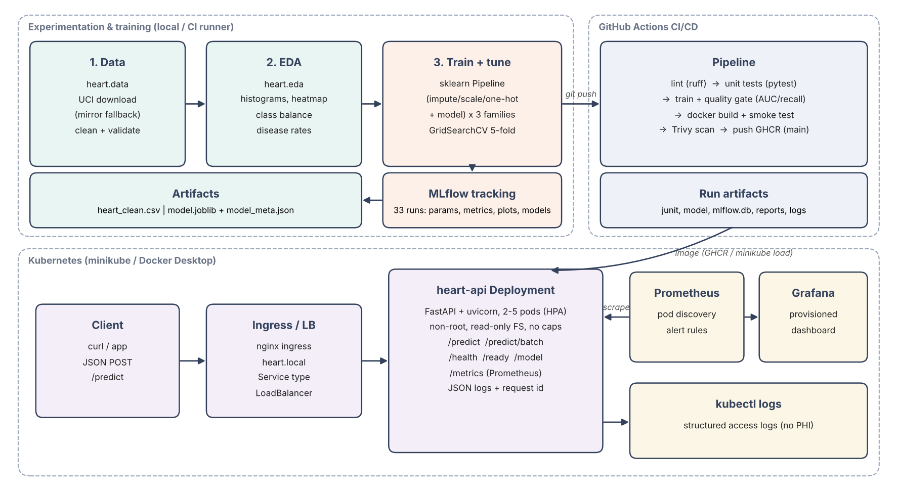

# Heart Disease Risk — End-to-End MLOps

Binary classifier for heart-disease presence on the UCI Heart Disease (Cleveland) dataset,
taken from raw data to a monitored API on Kubernetes.

**Repository:** https://github.com/Sai-Rakshith-2209/heart-mlops &nbsp;|&nbsp;
**Course:** AIMLCZG523 MLOps — Assignment 1



| Stage | Implementation |
|---|---|
| Data | `python -m heart.data` — official UCI file (pinned CA bundle), GitHub mirror fallback; schema/range validation; target binarised (`num > 0`) |
| EDA | `python -m heart.eda` — class balance, per-class histograms, disease-rate by category, correlation heatmap, box plots |
| Features | One `sklearn` Pipeline: median impute + scale (numeric), mode impute (binary), mode impute + one-hot (categorical) |
| Models | Logistic Regression, Random Forest, HistGradientBoosting — `GridSearchCV`, 5-fold stratified, refit on ROC-AUC |
| Tracking | MLflow: 3 parent runs + 30 nested candidate runs; params, CV + test metrics, plots, model with input/output signature |
| Packaging | `models/model.joblib` (full pipeline) + `model_meta.json` (run id, metrics, data SHA-256, versions); MLflow model (skops) |
| CI/CD | GitHub Actions (all actions pinned to commit SHAs): ruff → pytest → train + data check + quality gate → Docker build + smoke test → push to GHCR → minikube deploy + monitoring evidence |
| Serving | FastAPI: `/predict`, `/predict/batch`, `/health`, `/ready`, `/model`, `/metrics`; strict input schema |
| Deploy | Kubernetes (minikube): Deployment (2–5 pods, HPA, PDB, restricted PSS), LoadBalancer Service, nginx Ingress |
| Monitoring | Prometheus (pod discovery + alert rules) + provisioned Grafana dashboard; JSON access logs with request id; bounded metric labels |

## Results (held-out test set, n = 61)

| Model | CV ROC-AUC | Test ROC-AUC | Test accuracy | Test recall | Test precision |
|---|---|---|---|---|---|
| **Logistic Regression (champion)** | **0.907** | **0.960** | 0.869 | 0.929 | 0.813 |
| Random Forest | 0.901 | 0.955 | 0.885 | 0.929 | 0.839 |
| HistGradientBoosting | 0.889 | 0.951 | 0.885 | 0.893 | 0.862 |

The champion is chosen on **cross-validated** ROC-AUC, never on the test set. Identical
metrics were reproduced on Linux (Python 3.10, 3.13) and Windows (Python 3.11).

## Quick start (Linux / Prayogshala)

Supported Python: 3.10–3.12 (Prayogshala ships 3.10).

```bash
cd ~/workspace                                   # Prayogshala: only ~/workspace survives a stop
git clone https://github.com/Sai-Rakshith-2209/heart-mlops.git
cd heart-mlops
python3 -m venv .venv && source .venv/bin/activate
python -m pip install --upgrade pip
pip install -r requirements-dev.txt -e .

python -m heart.data      # download + clean   -> data/processed/heart_clean.csv
python -m heart.eda       # figures            -> reports/figures/
python -m heart.train     # tune + track       -> mlflow.db, models/model.joblib
ruff check . && ruff format --check . && python -m pytest -vv
mlflow ui --backend-store-uri sqlite:///mlflow.db --host 127.0.0.1 --port 5000   # MLflow UI
uvicorn heart.api:app --port 8000                                                 # API, docs at /docs
```

Windows (Git Bash): `py -3.11 -m venv .venv && source .venv/Scripts/activate`, then the same commands.

### API

```bash
curl -X POST http://localhost:8000/predict -H 'Content-Type: application/json' -d @sample_request.json
# {"prediction":1,"label":"heart_disease","confidence":0.8986,"probability_disease":0.8986,
#  "model_name":"logistic_regression","model_version":"1.0.0"}
```

`ca` and `thal` are optional (imputed). Out-of-range values, invalid codes and unknown
fields return **422**; batches above 100 return **413**.

## Docker, Kubernetes and monitoring

**In CI (no local Docker needed).** Every push to `main` runs the full chain on GitHub's
runners: the `docker` job builds and smoke-tests the image, and the `deploy` job starts
minikube, deploys the API (LoadBalancer + Ingress) and Prometheus + Grafana, generates
traffic and captures evidence. Download the **deploy-evidence** and **docker-smoke-test**
artifacts from the run page for screenshots, transcripts and pod logs.

**Locally (any Linux host with Docker + minikube):**

```bash
./scripts/docker_smoke_test.sh     # build, run, /ready, /predict, 422 check, healthy, non-root
./scripts/ci_deploy.sh             # minikube deploy + monitoring + evidence in deploy-evidence/
```

Other options: `./scripts/deploy_docker_desktop.sh` (Docker Desktop Kubernetes),
`./scripts/deploy_minikube.sh` (interactive minikube), or without a cluster:
`export GRAFANA_ADMIN_PASSWORD=$(openssl rand -hex 12) && docker compose up -d --build`.

## Repository layout

```
src/heart/      config, data, eda, features, train, api
tests/          test_data.py, test_model.py, test_api.py (21 tests)
notebooks/      heart_disease_eda_modelling.ipynb (executed)
data/processed/ heart_clean.csv            models/  model.joblib, model_meta.json
k8s/            namespace, deployment, service, ingress, hpa+pdb, prometheus RBAC
k8s/monitoring/ prometheus + grafana (kustomize), dashboard JSON, alert rules
.github/workflows/ci.yml   Dockerfile   docker-compose.yml   Makefile
scripts/        docker_smoke_test.sh, ci_deploy.sh, capture_evidence.py, deploy_*.sh,
                load_test.py, predict_client.py, draw_architecture.py
reports/        figures, model_comparison.csv, eda_summary.json, report
screenshots/    evidence for the report
```

## Design notes

- **No train/serve skew:** the artifact is the whole fitted Pipeline; the API never re-implements preprocessing.
- **No leakage:** imputation/scaling statistics are learned inside each CV fold.
- **Traceability:** every image carries `model_meta.json` (MLflow run id, data SHA-256, library versions), exposed on `/model` and as the `model_info` metric.
- **Reproducibility across OSes:** pinned dependencies and CA bundle, LF-only CSV outputs and `.gitattributes`, so data hashes and metrics match on Windows and Linux.
- **Privacy:** logs record request id, route, status, latency and predicted label — never patient features.
- **Hardening:** non-root UID 10001, read-only root FS, all capabilities dropped, seccomp RuntimeDefault, restricted Pod Security Standard, minimal serving dependencies, bounded metric labels, validated request ids, CI actions pinned to commit SHAs.